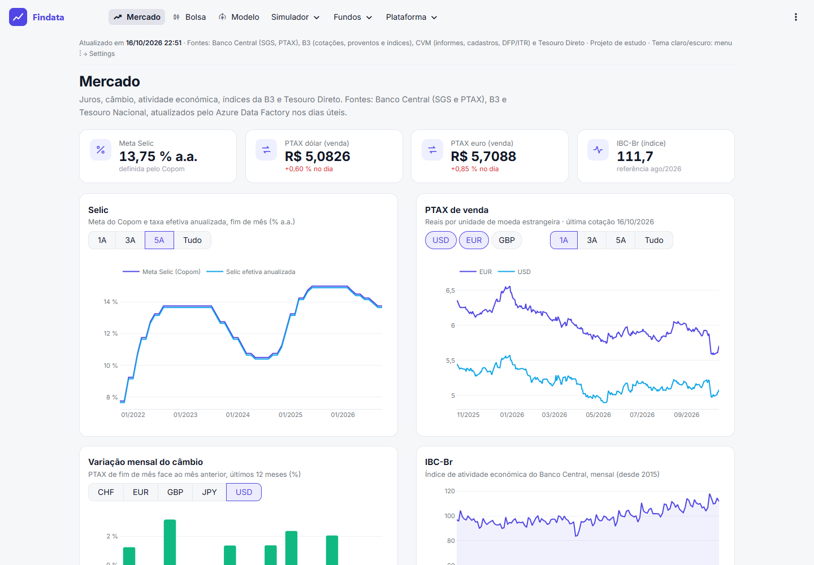
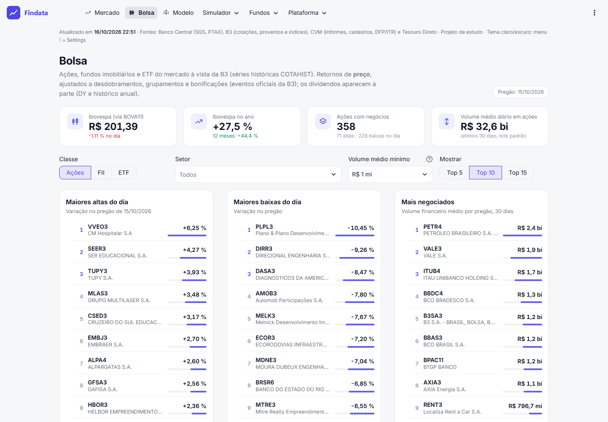
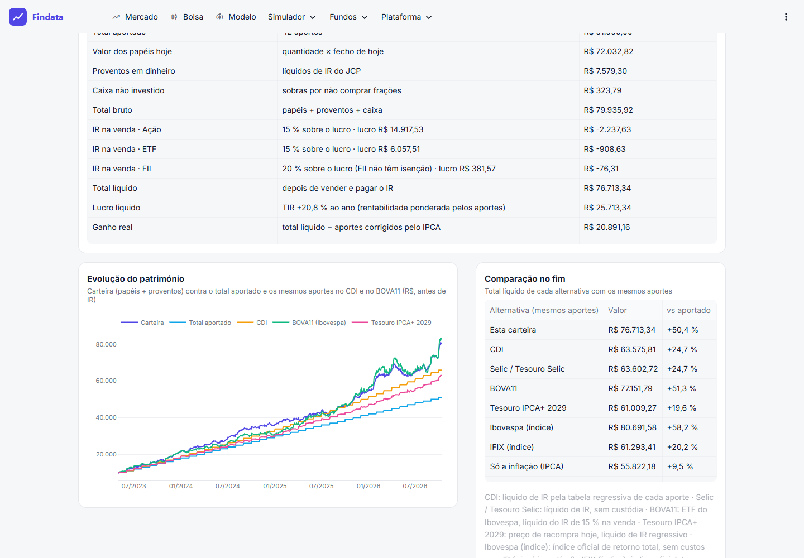
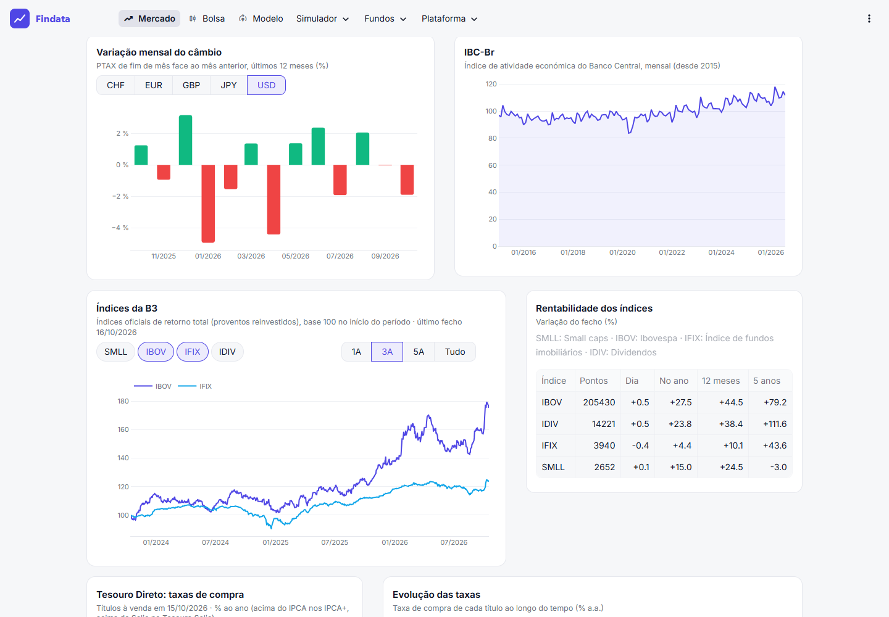
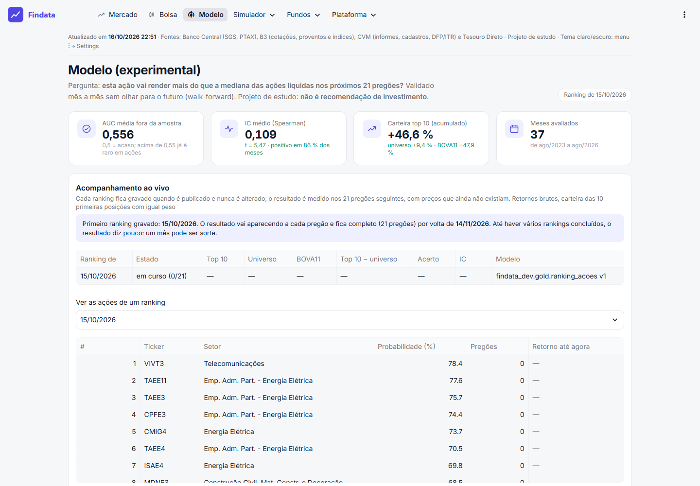
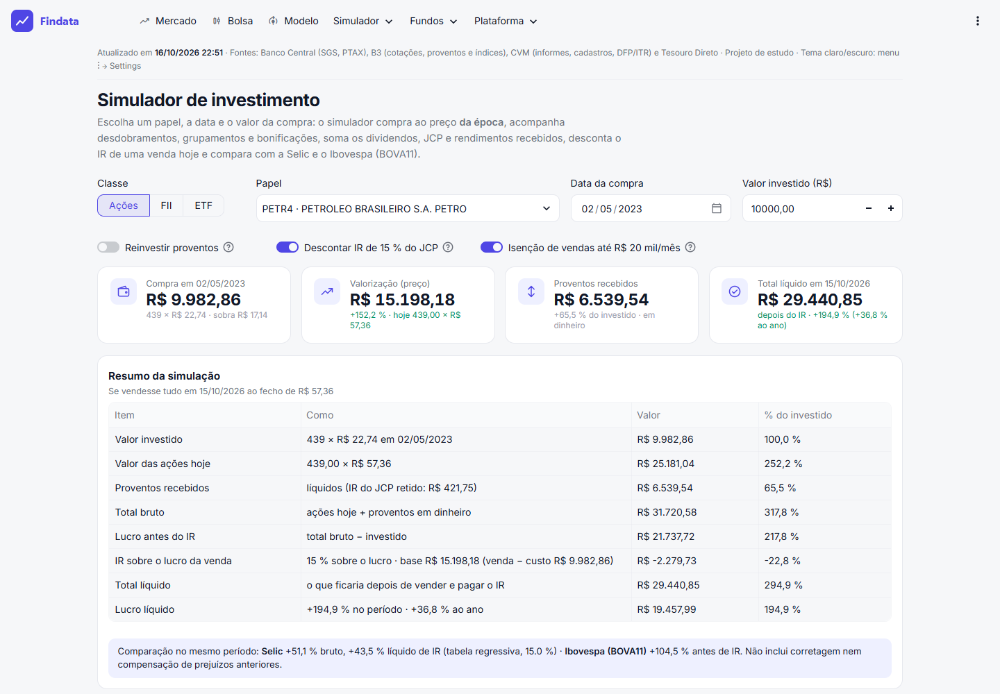
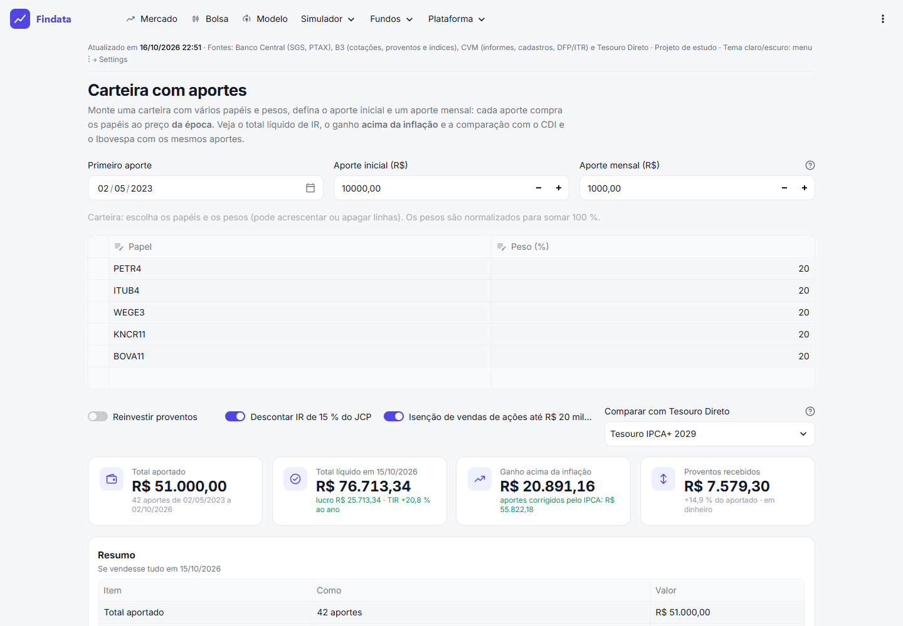
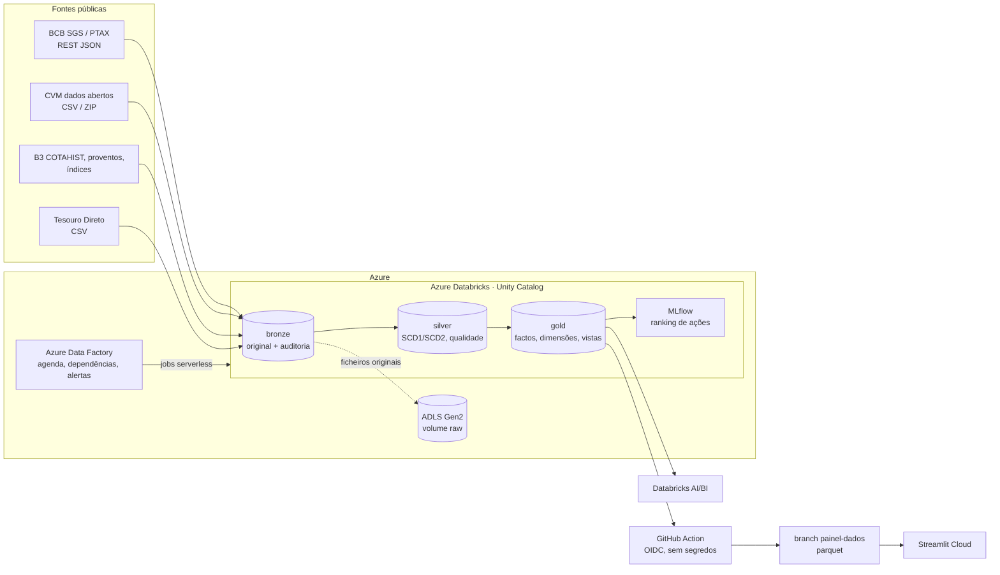

# Brazilian Financial Data Platform

Plataforma de engenharia de dados financeiros em Azure, em arquitetura medalhão, com fontes públicas brasileiras:
Banco Central (SGS e PTAX), CVM (fundos, FII, companhias abertas, DFP/ITR), B3 (cotações, proventos, índices) e
Tesouro Direto. Inclui um painel público, um simulador de investimentos e um modelo preditivo acompanhado ao vivo.
Projeto de estudo, sem vínculo com o BCB, a CVM, a B3 ou o Tesouro Nacional; não é recomendação de investimento.

**Painel:** https://findata-depoussis.streamlit.app, atualizado automaticamente todos os dias úteis.



| | |
|---|---|
|  |  |
|  |  |
|  |  |

## Arquitetura



- **Ingestão:** clientes HTTP com retries e contratos de esquema; cada ficheiro ou resposta original fica no volume
  `raw` com hash. A bronze da B3 usa **Auto Loader**, e a gold das cotações é incremental por **Change Data Feed**.
- **Histórico e auditoria:** SCD1/SCD2, watermarks, registo de ficheiros, deteção de reapresentações e reconciliação
  semanal com as fontes.
- **Qualidade:** regras CRITICAL/HIGH/INFO gravadas por execução. Uma falha crítica bloqueia a publicação na gold, e
  a frescura é verificada contra `config/sla.yaml`.
- **Orquestração:** ADF é o único agendador, com o pipeline diário (BCB, CVM, B3, Mercado e depois Frescura) e o
  semanal (auditoria, proventos e depois modelo). Alertas por e-mail.
- **Analytics:** modelo dimensional, painel AI/BI no Databricks e painel Streamlit a partir de um snapshot exportado
  diariamente por uma GitHub Action com identidade federada (sem tokens guardados).
- **ML:** variáveis point-in-time, validação walk-forward, backtest com custos, registo no Unity Catalog e
  **acompanhamento ao vivo**: os rankings publicados nunca são reescritos e o resultado é medido depois.

**Stack:** Azure Databricks (PySpark, Delta Lake, Unity Catalog, serverless, MLflow) · Azure Data Factory ·
ADLS Gen2 · Key Vault · Log Analytics / Azure Monitor · Bicep · GitHub Actions · Streamlit · Python 3.11 · pytest.

## Em números (16/10/2026)

| | |
|---|---|
| Informe diário de fundos (CVM) | 17,9 M linhas desde 2024 |
| Cotações B3 (ações, FII, ETF) | desde 2021, ~950 papéis com negócios recentes |
| Proventos B3 | dividendos e JCP desde 2007, eventos oficiais (desdobramentos, bonificações) |
| Séries do Banco Central | 9 séries SGS desde 2000, PTAX desde 2015 |
| Índices B3 e Tesouro Direto | 4 índices desde 2015; 177 mil preços/taxas desde 2004 |
| Testes | 84 testes unitários (pytest) + 63 casos de integração documentados |
| Modelo (37 meses fora da amostra) | AUC 0,556, IC 0,11 (t = 5,5); carteira top 10 +46,6 % vs universo +9,4 % |
| Custo | ~19 € em cargas iniciais; recorrente esperado 6–10 €/mês ([custos](docs/cost_estimation.md)) |

## Painel (Streamlit)

| Página | Conteúdo |
|---|---|
| Mercado | Selic, PTAX, câmbio, IBC-Br, índices B3 (IBOV, IFIX, SMLL, IDIV), taxas do Tesouro Direto |
| Bolsa | rankings de ações, FII e ETF; P/L, P/VP, ROE, DY; dividendos por ano |
| Modelo | acompanhamento ao vivo, backtest, comparação de modelos, importância das variáveis, ranking atual |
| Simulador ▸ Um papel | compra numa data ao preço da época: eventos, proventos, IR na venda, total líquido |
| Simulador ▸ Carteira com aportes | vários papéis e aportes mensais: TIR, ganho acima do IPCA, CDI, Tesouro, BOVA11, IBOV e IFIX com os mesmos aportes |
| Fundos | fundos de investimento, FII e análise de um fundo contra a Selic |
| Plataforma | execuções, qualidade, frescura e reconciliação |

## Estado

| Fase | Conteúdo | Estado |
|---|---|---|
| 1. Fundação | Infraestrutura, ADLS, RBAC, Unity Catalog, repositório, tabelas de controlo | concluída (16/10/2026) |
| 2. Banco Central | SGS (incluindo IPCA e CDI) e PTAX: histórico e incremental, bronze/silver/gold | concluída, ver [docs/pipelines_bcb.md](docs/pipelines_bcb.md) |
| 3. CVM | Catálogo, ficheiros históricos, ZIP, fundos e companhias abertas | concluída, ver [docs/pipelines_cvm.md](docs/pipelines_cvm.md) |
| 3b. B3 | Cotações (ações, FII, ETF), ticker → companhia pelo FCA da CVM, eventos oficiais | concluída, ver [docs/pipelines_b3.md](docs/pipelines_b3.md) |
| 3c. Streaming | Auto Loader na bronze e Change Data Feed na gold da B3 | concluída, ver [docs/streaming.md](docs/streaming.md) |
| 3d. Fundamentos e proventos | DFP/ITR da CVM; dividendos, JCP e eventos oficiais da B3 | concluída, ver [docs/fundamentos.md](docs/fundamentos.md) |
| 3e. Referências de mercado | Índices oficiais da B3 e preços/taxas do Tesouro Direto | concluída, ver [docs/pipelines_mercado.md](docs/pipelines_mercado.md) |
| 4. Histórico e auditoria | SCD1, SCD2, hashes, watermarks, reapresentações, reconciliação | concluída, ver [docs/auditoria.md](docs/auditoria.md) |
| 5. Orquestração | ADF, Databricks Jobs, retries, alertas, agendamentos | concluída, ver [docs/orquestracao.md](docs/orquestracao.md) |
| 6. Qualidade e analytics | Testes de dados, modelo dimensional, indicadores, painéis | concluída, ver [docs/analytics.md](docs/analytics.md) |
| 6b. Modelo preditivo | Ranking de ações: point-in-time, walk-forward, backtest, MLflow, acompanhamento ao vivo | experimental, ver [docs/modelo_preditivo.md](docs/modelo_preditivo.md) |
| 6c. Simulador | Um papel e carteira com aportes: eventos, proventos, IR, TIR, IPCA, comparações | concluída, ver [docs/simulador.md](docs/simulador.md) |
| 6d. Atualização automática | GitHub Action (OIDC) exporta o snapshot às 23:00 para o branch `painel-dados` | concluída, ver [docs/analytics.md](docs/analytics.md) |
| 7. Produção | CI/CD, segurança, monitorização, custos, DR | em curso: CI/CD no Azure DevOps ([docs/cicd.md](docs/cicd.md)), custos ([docs/cost_estimation.md](docs/cost_estimation.md)) |

Fases 1 a 6 concluídas entre 15 e 16/10/2026.

## Estrutura

```text
infrastructure/bicep/     main.bicep, módulos e parâmetros por ambiente
config/                   ambientes (sem segredos), fontes, datasets, séries, SLA de frescura
src/common/               configuração, HTTP com retries, raw, janelas, utilitários SQL
src/ingestion/            BCB (SGS, PTAX), CVM (contrato, ZIP, codificação), B3 (COTAHIST, proventos), mercado
src/bronze|silver|scd/    escrita bronze, MERGE SCD1/SCD2
src/quality/ src/audit/   regras de qualidade; execuções, watermarks e registo de ficheiros
src/gold/ src/ml/         cálculos da gold (cotações, fundamentos); variáveis e avaliação do modelo
sql/                      DDL: control, schemas (bronze/silver), dimensions, facts, views, grants
notebooks/                bronze, silver, gold, ml, audit e testes de integração (formato fonte do Databricks)
scripts/                  deploy de RBAC, Unity Catalog, SQL, workspace/jobs, ADF, painéis; exportação do snapshot
pipelines/azure_data_factory/  linked service, pipelines e gatilhos (JSON)
.github/workflows/        exportação diária do painel (OIDC)
app/                      painel Streamlit (páginas, cálculos do simulador, leitura do snapshot)
tests/unit/               testes sem Spark (pytest)
docs/                     arquitetura, pipelines, conceitos, testes, custos, deployment
```

## Começar

Ver [docs/deployment.md](docs/deployment.md). Resumo:

```bash
az deployment group create -g rg-findata-dev -n fundacao-dev -p infrastructure/bicep/environments/dev.bicepparam
bash scripts/deploy_rbac.sh dev
python scripts/setup_unity_catalog.py --env dev
python scripts/apply_sql.py --env dev --dir sql/control --dir sql/schemas --dir sql/dimensions --dir sql/facts --dir sql/views
python scripts/deploy_workspace.py --env dev --run backfill
python scripts/deploy_adf.py --env dev          # ADF: linked service, pipelines, gatilhos (parados)
python scripts/deploy_dashboard.py --env dev    # painel AI/BI no Databricks
python scripts/exportar_painel.py --env dev     # snapshot do painel Streamlit (app/)
python -m pytest -q
```

## Documentação

[Arquitetura](docs/architecture.md) · [Conceitos](docs/conceitos.md) (Delta, Auto Loader, marca d'água, SCD,
point-in-time) · [Testes](docs/testes.md) · [Orquestração](docs/orquestracao.md) · [Auditoria](docs/auditoria.md) ·
[Custos](docs/cost_estimation.md) · [CI/CD](docs/cicd.md) · [Deployment](docs/deployment.md)
