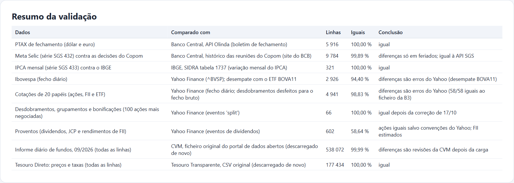
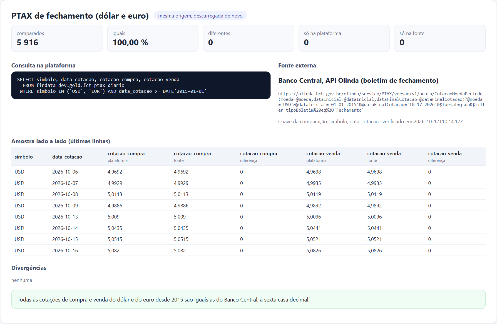
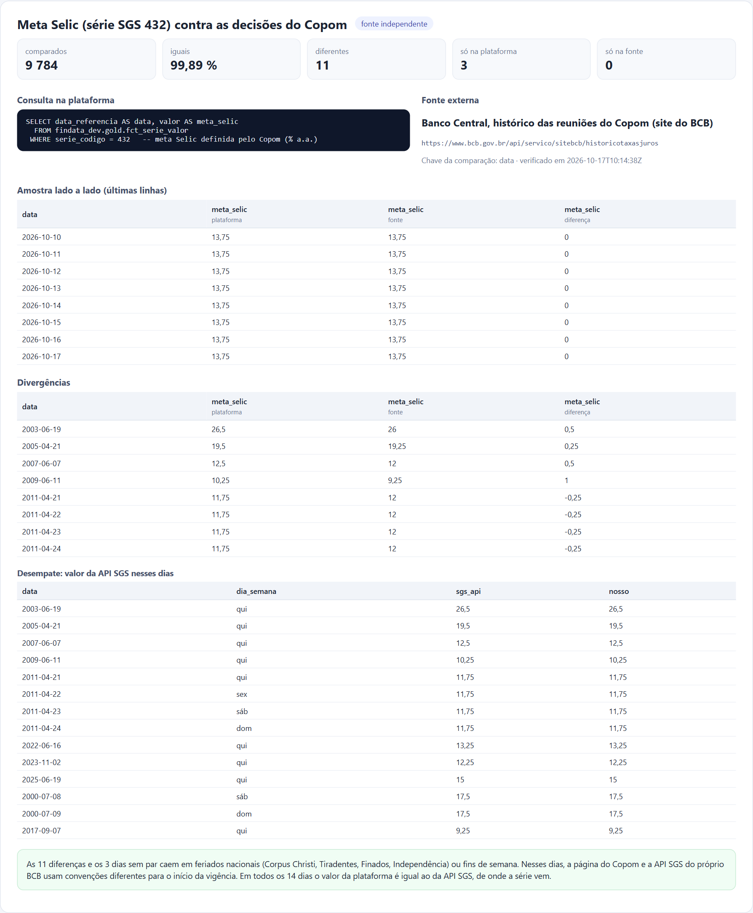
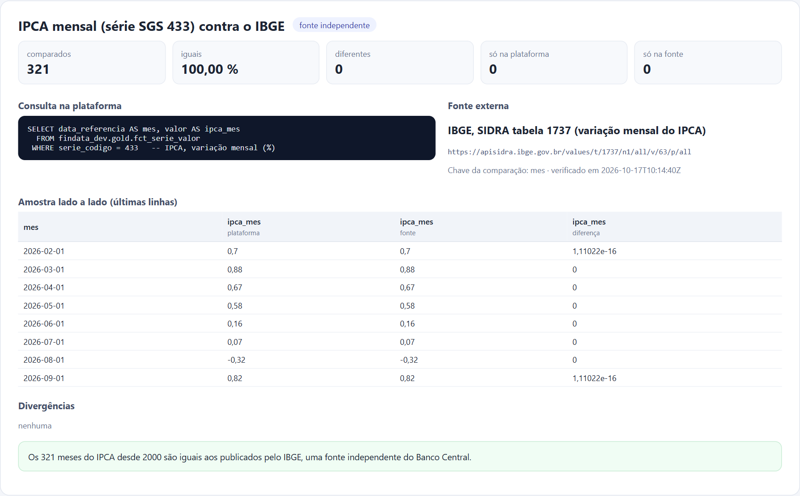
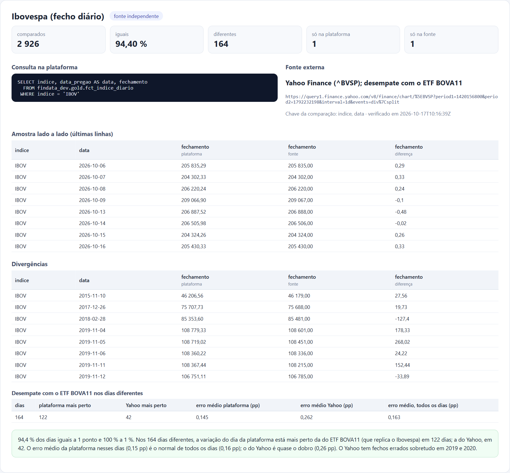
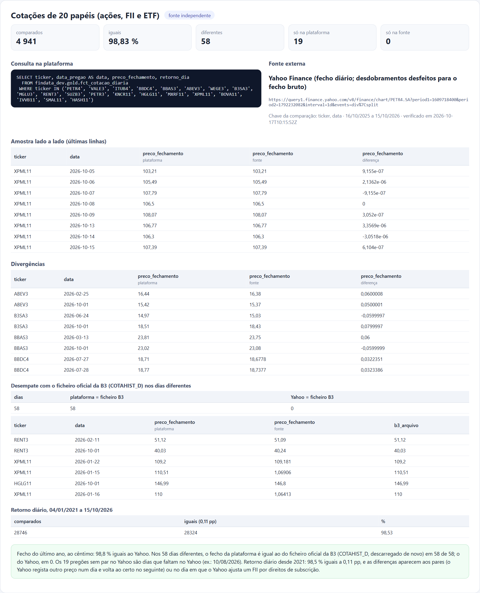
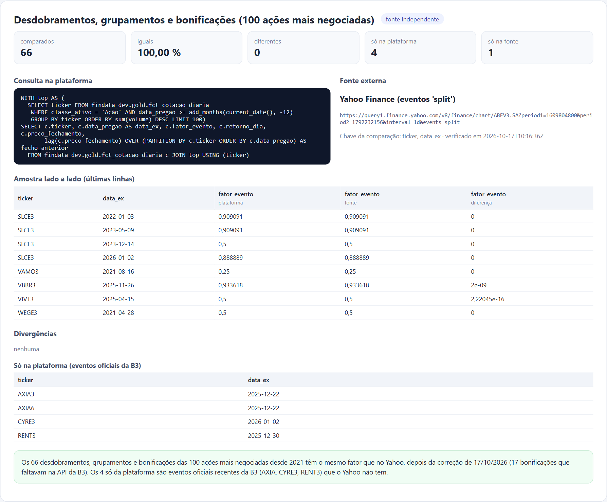
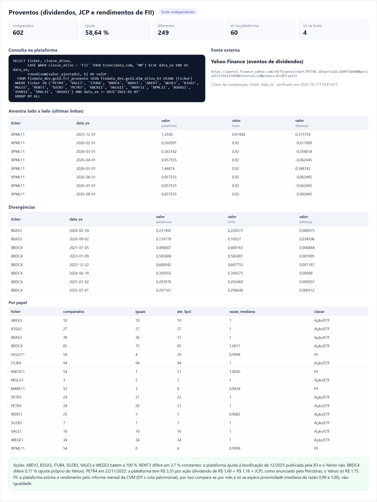
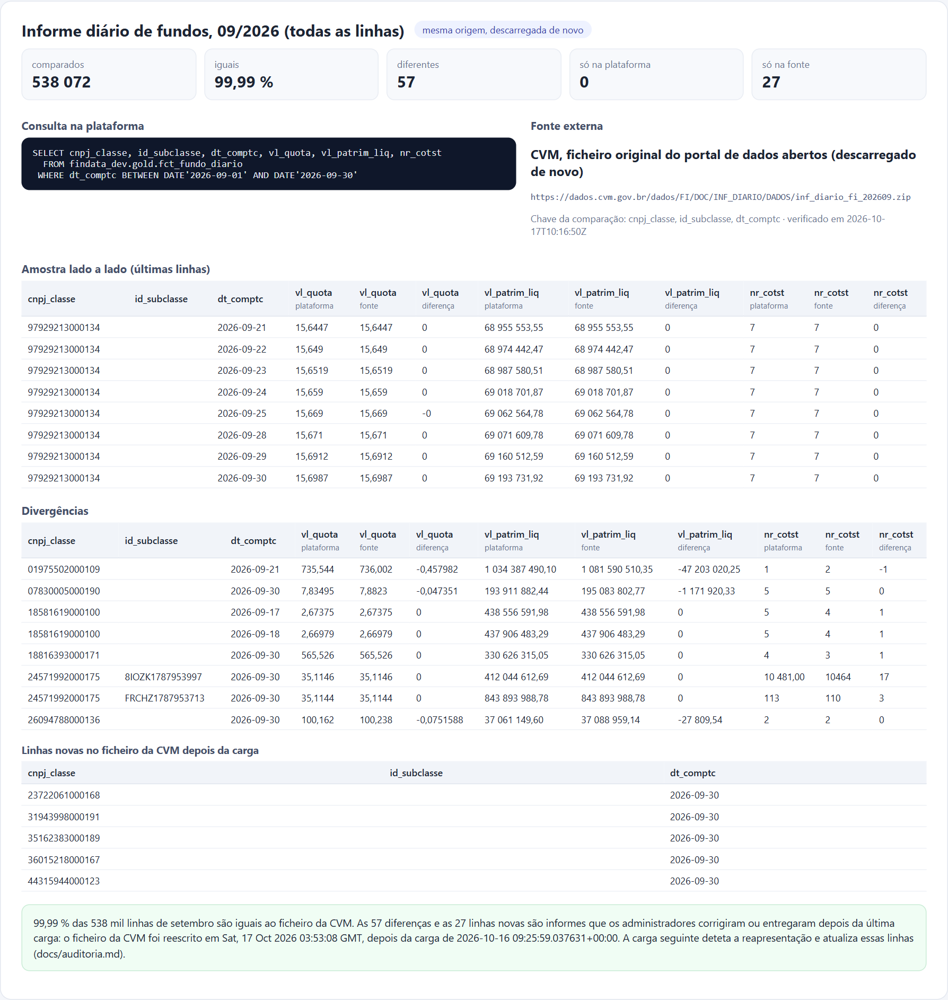
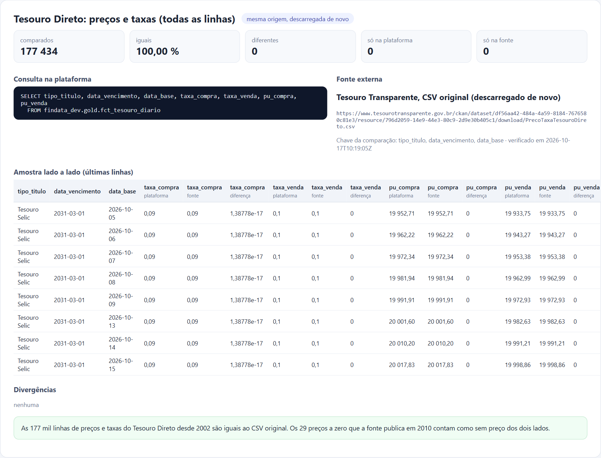

# Validação dos dados contra fontes externas

Validação feita em 17/10/2026. As tabelas gold da plataforma foram comparadas, linha a linha, com fontes externas.
Sempre que existia, usou-se uma fonte **independente**: IBGE, decisões do Copom, Yahoo Finance. Quando não existia,
usou-se o **ficheiro original**, descarregado de novo e lido por código diferente do pipeline.

Reproduzir:

```bash
python scripts/validar_fontes.py --env dev       # consultas no SQL Warehouse + fontes externas → docs/validacao/resultado.json
python scripts/relatorio_validacao.py            # → docs/validacao/relatorio.html (as imagens abaixo são capturas dele)
```

A validação só lê dados e não altera a plataforma. Os erros que encontrou foram corrigidos no pipeline e estão
descritos [mais abaixo](#erros-encontrados-e-corrigidos).



## Como ler os resultados

- **Iguais:** a mesma chave existe nos dois lados com o mesmo valor, dentro de uma tolerância indicada em cada caso
  (ex.: 1 cêntimo nas cotações, 1e-6 nas taxas do Tesouro).
- **Só na plataforma / só na fonte:** chaves que existem apenas de um lado.
- **Desempate:** quando a plataforma e a fonte externa discordam, procurou-se uma terceira referência para saber
  qual delas está certa:
  - o ficheiro oficial da B3, para as cotações;
  - o ETF BOVA11, para o Ibovespa;
  - a API SGS, para a Selic.
- **100 % só se espera onde a fonte é a mesma.** Fontes independentes seguem convenções diferentes: ajustes de
  preços, feriados, datas. Por isso as diferenças foram investigadas uma a uma. Cada secção diz de que lado está
  cada uma.

## Banco Central

### PTAX: 100 % igual (5 916 cotações)


### Meta Selic: diferenças só em feriados
A API SGS e a página do Copom, ambas do BCB, discordam sobre o dia em que a nova meta começa quando a reunião
calha num feriado. Nesses 14 dias, a plataforma tem o valor da API SGS, de onde a série vem.



### IPCA: 100 % igual ao IBGE (321 meses)


## B3

### Ibovespa: as diferenças estão no Yahoo
Coincidem 94,4 % dos dias a 1 ponto e 100 % a 1 %. Nos 164 dias diferentes, a variação diária da plataforma acompanha
a do BOVA11 tão bem como nos outros dias. A do Yahoo tem quase o dobro do erro. O Yahoo tem fechos errados sobretudo
em 2019 e 2020. O IFIX não foi comparado: o Yahoo não tem o histórico.



### Cotações: a plataforma é igual ao ficheiro oficial da B3 em 58 de 58 divergências
Foram comparados 20 papéis: ações, FII e ETF. No último ano, 98,8 % dos fechos coincidem ao cêntimo. Nos 58 dias em
que o Yahoo difere, descarregou-se de novo o ficheiro diário oficial da B3:
- o fecho da plataforma é igual ao da B3 em **58 dias**;
- o do Yahoo, em **nenhum**.

Num dos casos o Yahoo regista o XPML11 a R$ 1,07 em vez de R$ 110,51.



### Desdobramentos, grupamentos e bonificações: 66 de 66 iguais
A comparação cobre as 100 ações mais negociadas, desde 2021. O resultado é o que ficou depois da correção descrita
abaixo: antes dela, faltavam 17 bonificações.



### Proventos
- **Ações:** depois das correções abaixo, ABEV3, B3SA3, ITUB4, SUZB3, VALE3 e WEGE3 batem a 100 %. As diferenças que
  restam estão do lado do Yahoo:
  - **RENT3:** o Yahoo não aplica a bonificação de 12/2025 que a B3 publica.
  - **BBDC4:** o Yahoo aplica um ajuste próprio de 0,17 %.
  - **PETR4:** em 22/11/2022 o Yahoo só tem R$ 1,75 dos R$ 3,35 por ação anunciados pela Petrobras.
- **FII:** a plataforma **estima** o rendimento pelo informe mensal da CVM (DY × cota patrimonial). Por isso a
  comparação é feita por mês e só se espera proximidade. A mediana da razão fica entre 0,99 e 1,00, mas há meses com
  mais de 1 % de diferença (MXRF11, XPML11). Isto é uma limitação conhecida: o valor exato só existe na B3, e apenas
  para cerca de 12 meses.



## CVM: informe diário de fundos de 09/2026, 99,99 % de 538 mil linhas
As diferenças são correções que os administradores entregaram depois da última carga. O ficheiro da CVM foi
reescrito depois dessa carga, e a carga seguinte deteta a reapresentação e atualiza as linhas
([auditoria.md](auditoria.md)).



## Tesouro Direto: 100 % igual (177 mil linhas desde 2002)


## Erros encontrados e corrigidos

A validação encontrou três erros reais. Em todos, a origem estava na forma como a API da B3 publica os dados. Todos
foram corrigidos e verificados de novo.

| Problema | Impacto | Correção |
|---|---|---|
| A API de eventos da B3 não lista 17 bonificações. Exemplos: Itaú 10 % (17/03/2025), Bradesco 10 % (16/04/2021), Cemig 30 % (29/04/2022), quatro da Itaúsa. | Nesses dias o retorno diário mostrava uma queda falsa de 4 % a 23 %. Isto afetava o simulador, o preço ajustado e as variáveis do modelo. | `config/datasets/b3_eventos_complementares.yaml`: lista curada com origem e critério de entrada. Os eventos aplicam-se a todas as classes do emissor, e o oficial prevalece se a B3 o publicar mais tarde. A gold das cotações foi reconstruída. |
| A API de proventos não encontra nomes de pregão com barra. "AMBEV S/A" devolve 0 registos; "AMBEV SA" devolve o histórico. | Faltavam todos os proventos de 9 emissores: Ambev, Klabin, Light, Cury, Embpar, Ourofino, IMC, entre outros. | `url_dinheiro` retira a barra, como faz o site da B3. Teste em `tests/unit/test_b3.py`. |
| A B3 lista cada parcela de um provento como uma linha igual. Exemplo: Petrobras, 2 × R$ 0,55 com data com 25/04/2024. A silver tratava as parcelas como duplicados. | Faltavam 819 parcelas de 62 emissores. Na Petrobras, um dos maiores pagadores, faltava metade de vários proventos. | Nova coluna `parcela` na silver e na gold, incluída na chave. A migração está em `sql/migracoes/20261017_provento_parcela.sql`. |

Também foi corrigido um problema menor nos proventos anteriores a 2021, ano em que começa o histórico de cotações.
Esses proventos ficavam com data ex 04/01/2021 e passaram a não ter data ex. O simulador não era afetado, porque usa
a data com.

## Limites desta validação

- **Amostras:** as cotações e os proventos foram comparados em 20 papéis líquidos, e os eventos nas 100 ações mais
  negociadas. Os papéis pouco negociados não foram verificados um a um.
- **Fontes que não são independentes:** a PTAX, o Tesouro e os fundos da CVM só existem na própria fonte. Nestes
  casos a validação prova que o pipeline não perde nem altera dados, mas não prova que a fonte esteja certa.
- **Yahoo Finance:** não é uma fonte oficial. Serviu de referência independente, e as discordâncias foram
  desempatadas com dados oficiais.
- **Não validado contra fontes externas:** IFIX, SMLL e IDIV (sem fonte externa com histórico), demonstrações
  financeiras (DFP/ITR) e as séries IBC-Br e câmbio do SGS.
